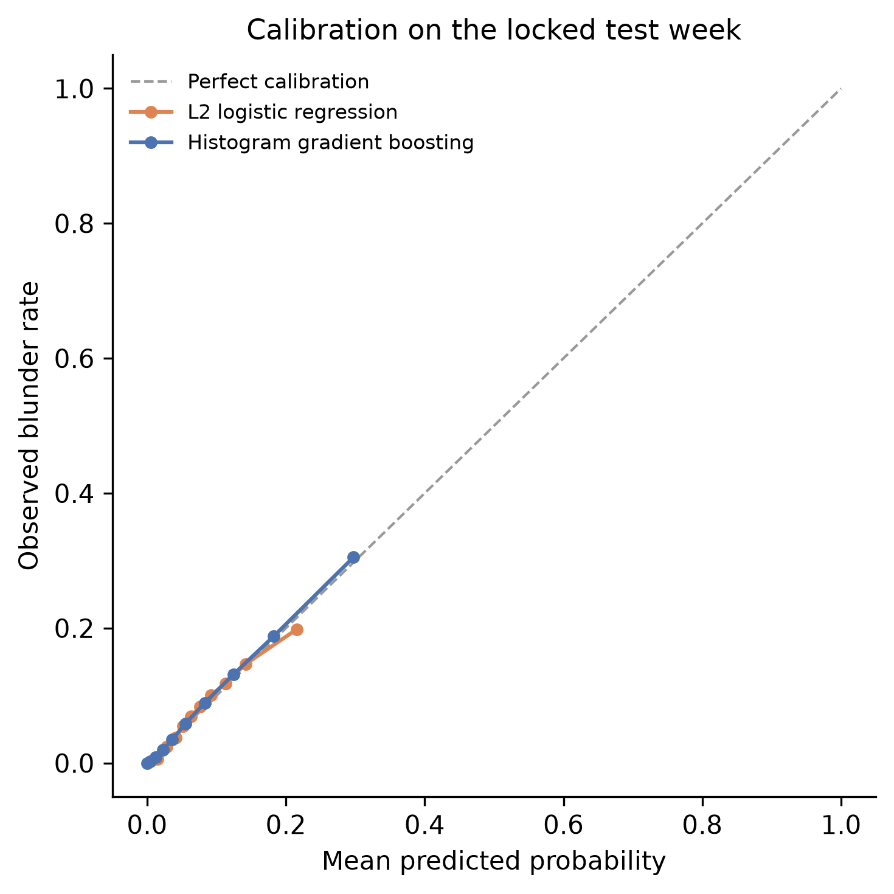
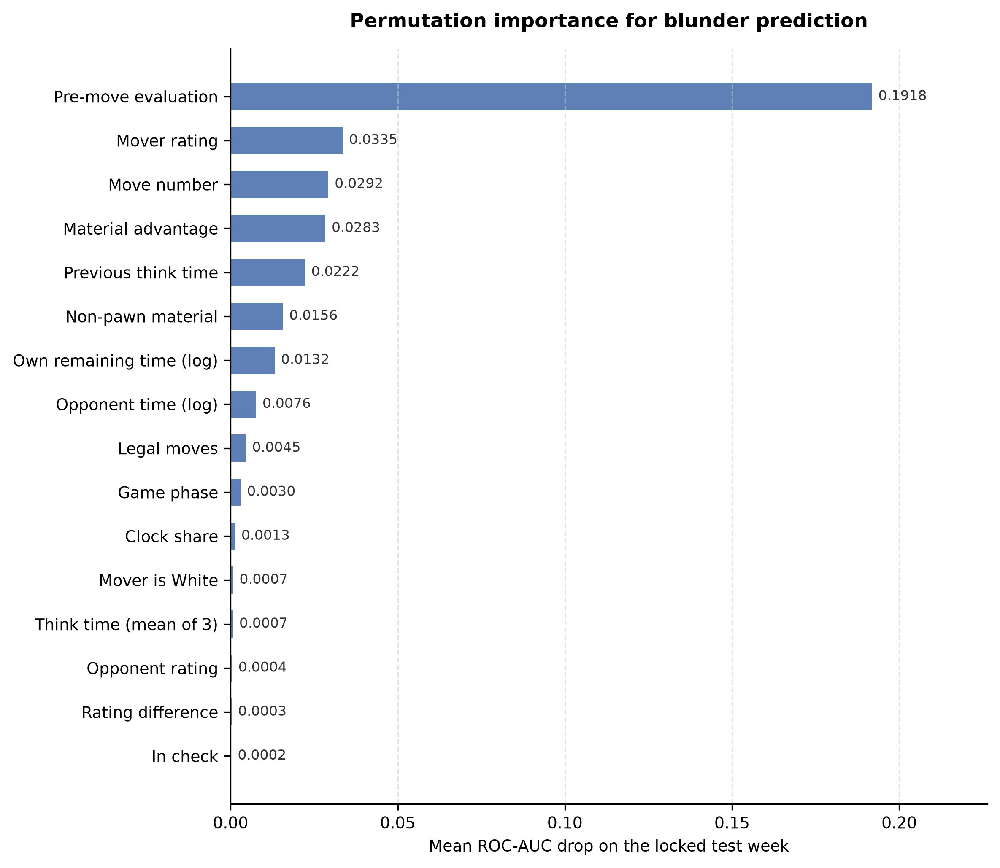
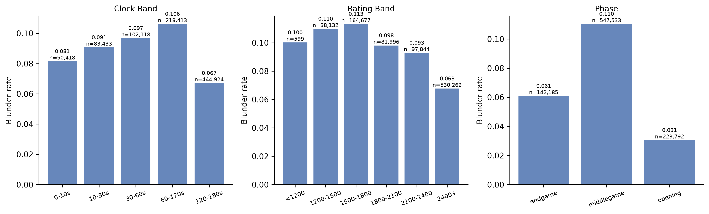

# Archived results from the distributed move table

The figures and tables below accompany the archived `results/metrics.json`. Original clock features include a one-half-move alignment error. Use these numbers for historical reproduction; use the [source-verified experiment ledger](../experiment/results.md) for the study conclusions.

All numbers below are produced by `scripts/train_model.py` and stored in
`results/metrics.json`; every figure is exported to `results/` as PDF (vector)
and PNG.

## 4.1 Analysis sample

After removing 25,872 fully duplicated rows (298 games had been written twice)
and moves without a label, the analysis sample contains 913,510 moves from
11,812 games played between 1 and 30 September 2026, with a positive rate of
8.31%. The label was re-derived from adjacent engine evaluations: the study
definition (`W(c_before) − W(c_after) ≥ 10` percentage points) reproduces the
stored label on all 903,656 rows where both evaluations exist. The training step consumed the numeric scores already stored in the table; the preceding conversion could encode forced mates as proxy scores. The distributed table has game identifiers but no player identifiers.

**Table 1. Analysis sample.**

| Item | Value |
|---|---|
| Date range | 2026-09-01 – 2026-09-30 (30 UTC days) |
| Rows in source file | 953,174 |
| Duplicated rows removed | 25,872 (298 games) |
| Moves used | 913,510 |
| Games used | 11,812 |
| Moves per day (min / mean / max) | 21,969 / 30,450 / 36,686 |
| Games per day (min / mean / max) | 298 / 394 / 472 |
| Positive rate (10 pp definition) | 8.31% |
| Positive rate in the locked test week | 8.37% |
| Label re-derivation agreement | 1.0000 (903,656 rows) |

## 4.2 Validation and model selection

Three expanding windows inside 1–23 September were used (train 1–8 / validate
9–13, train 1–13 / validate 14–18, train 1–18 / validate 19–23), with whole
games kept in one set. Spline bases, scaling and phase coding were fitted on
the training part of each window only. Configurations were ranked by mean
validation log loss; the test week was evaluated once.

**Table 2. Mean validation log loss across the three expanding windows.**

| Configuration | Window 1 | Window 2 | Window 3 | Mean |
|---|---|---|---|---|
| Logistic, C = 1.0 *(selected)* | 0.26926 | 0.26572 | 0.26811 | **0.26770** |
| Logistic, C = 0.3 | 0.26993 | 0.26509 | 0.26827 | 0.26776 |
| Logistic, C = 0.1 | 0.26994 | 0.26566 | 0.26863 | 0.26807 |
| Logistic, C = 0.03 | 0.27005 | 0.26575 | 0.26887 | 0.26822 |
| Boosting, 31 leaves, lr 0.05, leaf 100, L2 10 *(selected)* | 0.23864 | 0.23265 | 0.23441 | **0.23523** |
| Boosting, 63 leaves, lr 0.05, leaf 50, L2 1 | 0.23880 | 0.23252 | 0.23439 | 0.23523 |
| Boosting, 31 leaves, lr 0.05, leaf 50, L2 1 | 0.23863 | 0.23261 | 0.23448 | 0.23524 |
| Boosting, 15 leaves, lr 0.10, leaf 100, L2 1 | 0.23911 | 0.23285 | 0.23458 | 0.23551 |
| Boosting, 31 leaves, lr 0.10, leaf 50, L2 1 | 0.23919 | 0.23303 | 0.23462 | 0.23561 |

Boosting configurations differ by less than 0.0005 log loss, i.e. below any
meaningful resolution; the selected one is the first in the ranking.

## 4.3 Performance on the locked test week

The final models were refitted on 1–23 September (700,215 moves) and evaluated
once on 213,295 moves from 2,752 games dated 24–30 September (prevalence
8.37%).

**Table 3. Test-week performance.**

| Model | Log loss ↓ | Brier ↓ | ROC-AUC | Average precision | Precision | Recall | F1 |
|---|---|---|---|---|---|---|---|
| Prevalence benchmark | 0.28781 | 0.07673 | 0.5000 | 0.0837 | – | – | – |
| L2 logistic (splines + interactions) | 0.26660 | 0.07369 | 0.7082 | 0.1672 | 0.168 | 0.451 | 0.245 |
| Histogram gradient boosting | **0.23127** | **0.06737** | **0.8235** | **0.2800** | 0.258 | 0.541 | 0.349 |

Precision, recall and F1 are reported at the operating threshold chosen on the
19–23 September validation window (0.119 for logistic, 0.164 for boosting), not
at 0.5. Both models improve on the prevalence benchmark; boosting improves log
loss by 0.035 over the interpretable model.

**Table 4. Paired bootstrap over whole test games (1,000 resamples, 95% percentile CI).**

| Contrast | Δ log loss | Δ average precision |
|---|---|---|
| Boosting − logistic | −0.0354 [−0.0368, −0.0340] | +0.1130 [+0.1065, +0.1197] |
| Boosting − prevalence benchmark | −0.0566 [−0.0584, −0.0549] | +0.1965 [+0.1888, +0.2039] |

Both intervals exclude zero, so the ranking of models survives game-level
resampling. The intervals treat games as independent; repeated players are not
modelled and would widen them.

**Figure 1.** Calibration on the locked test week (213,295 moves, ten
quantile bins). The diagonal is perfect calibration. Boosting tracks it closely
(mean predicted 0.0819 against the observed 0.0837; top bin 0.298 against
0.305). The logistic model is less well calibrated in the tails: it
under-predicts around 0.08 (0.076 predicted against 0.083 observed) and
over-predicts in its top bin (0.215 against 0.198).

**Figure 2.** Permutation importance for the selected boosting model: mean drop
in test ROC-AUC when a raw input is shuffled (50,000 sampled moves, five
repeats). The pre-move evaluation dominates (0.192), followed by mover rating
(0.034), move number (0.029) and material advantage (0.028). Importance values for the historical clock fields describe the misaligned inputs and cannot identify the value of the true pre-move clocks.

## 4.4 Ablations

Each ablation refits the selected configuration under the same protocol.

**Table 5. Ablation on the test week.**

| Inputs | Logistic log loss | Δ | Boosting log loss | Δ |
|---|---|---|---|---|
| Full feature set | 0.26660 | – | 0.23127 | – |
| No clock or thinking-time inputs | 0.27158 | +0.0050 | 0.23573 | +0.0045 |
| No pre-move evaluation | 0.26598 | −0.0006 | 0.25255 | +0.0213 |

Removing the stored timing columns raises log loss for both models and lowers average
precision by 0.024 (logistic) and 0.021 (boosting). The alignment error prevents attributing this difference to information available at the start of a turn. The pre-move evaluation is used very
differently by the two models: removing it is neutral for the linear model
(−0.0006, within noise) but costly for boosting (+0.0213 log loss, −0.076
average precision). The flexible model therefore earns part of its advantage by
exploiting position strength nonlinearly, which is exactly the comparison the
study set out to make.

## 4.5 Label sensitivity

**Table 6. Alternative label definitions.** Same temporal split and
hyper-parameters; 903,656 labelled moves in total, scored on the locked test
week. The 10 pp row reproduces Table 3.

| Label | Prevalence | Logistic log loss | Boosting log loss | Boosting AP |
|---|---|---|---|---|
| 5 pp winning-chance drop | 16.31% | 0.41393 | 0.36685 | 0.394 |
| 10 pp (primary) | 8.31% | 0.26660 | 0.23127 | 0.280 |
| 15 pp winning-chance drop | 5.11% | 0.18800 | 0.16319 | 0.213 |
| 150 cp loss | 9.66% | 0.29029 | 0.26228 | 0.308 |

The ordering of the models and the direction of the gains do not depend on the
threshold: boosting is better under every definition, by 0.025–0.047 log loss
and by 0.096–0.113 average precision. Absolute levels are not comparable across
definitions because prevalence changes.

## 4.6 Exploratory patterns

**Figure 3.** Archived sample counts and unadjusted error rates by stored clock field, mover rating and game phase. Rates were higher in the middlegame (0.110) than in the opening (0.031) or the endgame (0.061). The clock bins group values from the old table. For actual turn-start clocks, see the corrected comparisons and adjusted time profiles in the [experiment ledger](../experiment/results.md).

## 4.7 Limitations

1. **No player identifiers.** Games are the only clustering unit, and the
   proposed player-disjoint check could not be run on this table. Repeated players remain
   an unmodelled dependence, also inside the bootstrap intervals.
2. **Missing mate flags.** The archived move table contains only numeric engine scores. The original converter used proxy scores for mate annotations, so their provenance cannot be recovered from those columns alone.
3. **Sampling.** The sample is larger than the planning estimate (11,812 rather
   than ≤3,000 games), which tightens the intervals but does not remove
   selection on games that carry clocks and engine annotations.
4. **Scope.** One month of annotated blitz games. The old collector did not enforce initial time and increment; its sample contains more than the proposed 180+0 control.
5. **Interpretation.** The archived timing ablation describes how the stored columns affected a retrospective model. Source-verified pre-move clocks are necessary to estimate the available predictive gain. Engine availability, position difficulty and game length also limit causal interpretation.
